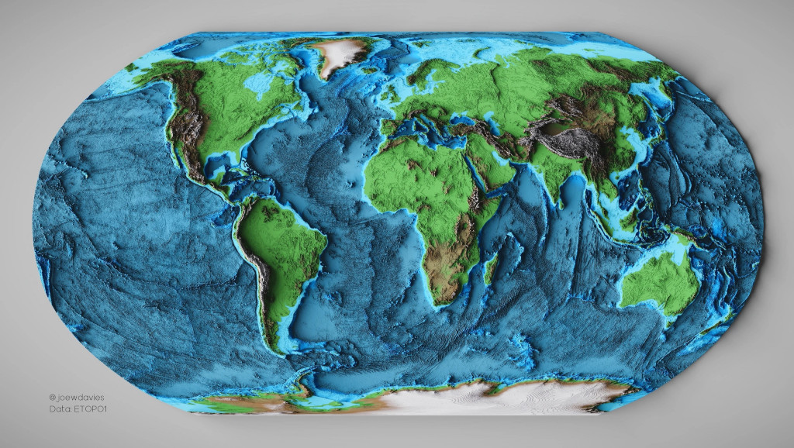
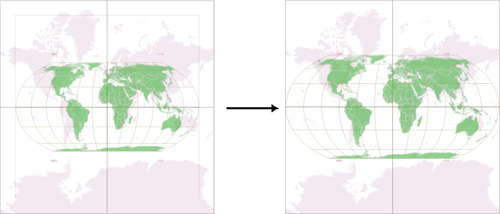
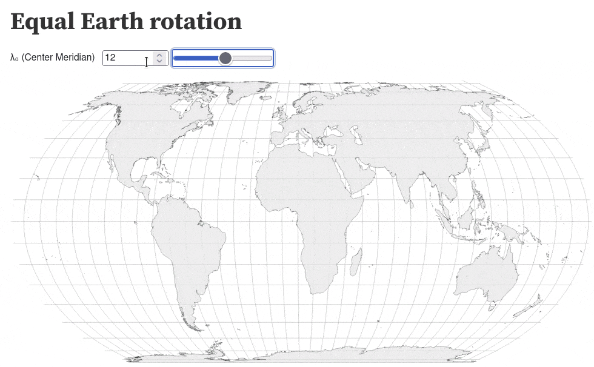
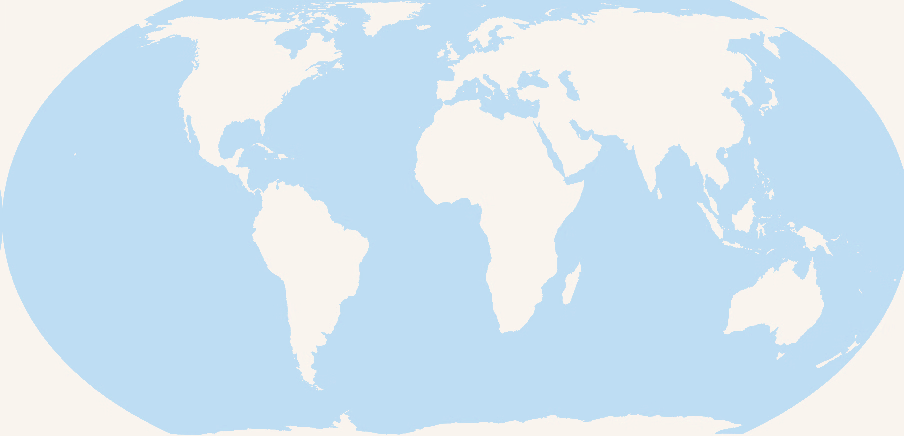

+++
title = "Equal Earth Web Mapping"
date = 2024-04-22
updated = 2026-11-01
+++

## Equal-area projection for web mapping

Most of today's web maps are using the [Web Mercator projection](https://en.wikipedia.org/wiki/Web_Mercator_projection). A major issue of Web Mercator is the distortion of area sizes far from the equator.

In 2018 Bojan Šavrič, Tom Patterson and Bernhard Jenny published their work on the [Equal Earth map projection](https://www.equal-earth.com/), an equal-area projection for world maps.



This site is an information collection about using the Equal Earth map projection for web mapping.

### Equal Earth projection codes

There are official EPSG codes for the following Equal Earth projection variants:
* Equal Earth Greenwich: EPSG:8857
* Equal Earth Americas: EPSG:8858
* Equal Earth Asia-Pacific: EPSG:8859

So most GIS software packages already support creating maps in Equal Earth projection.

## Data in WGS84 or Web Mercator

Existing data in geographic WGS84 coordinates or in Web Mercator projection can be reprojected
to Equal Earth by the map viewer.

Examples:
* [OpenLayers - GeoJSON with mouseover infos](/ol-geojson)
* [OpenLayers - FlatGeobuf](/fgb)
* [OpenLayers - OSM raster tiles](/ol-osm-proj)
* [OpenLayers - GeoParquet](/geoparquet)
* [OpenLayers - GeoZarr](/geozarr)
* [OpenLayers - PMTiles raster tiles](/pmtiles)
* [Gleo - styled GeoJSON](/gleo-geojson)

Other viewers:
* [Matplotlib add-on](https://dneuman.github.io/EqualEarth/)


## Data in Equal Earth projection

For viewers without reprojection support, data has to be in Equal Earth projection.

### Equal Earth vector tiles using Web Mercator grid

A quadratic grid for Equal Earth centered on Greenwich is similar to a Web Mercator grid.
Instead of Mercator grid corners at (-20'037'508, 20'037'508) and (20'037'508, -20'037'508)
the grid corners of Equal Earth Greenwich are at (-17'243'959, 17'243'959) and (17'243'959, -17'243'959).



Tiles produced in Equal Earth projection on a Equal Earth Greenwich grid can be adressed with
the same tile numbers by a map viewer using a Web Merctor grid. Tiles are displayed with a scale
factor of 1.162. Conversions between geographic WGS84 coordinates and the map coordinate reference
system give wrong results without adapted calculations.
But maps can be displayed without any coordinate projection calculations.

Basic usage examples:
* [MapLibre](/maplibre) | [Asia-Pacific centered](/maplibre-asia-pacific) | [Americas centered](/maplibre-americas)
* [OpenLayers](/openlayers) | [Asia-Pacific centered](/ol-asia-pacific) | [Americas centered](/ol-americas)
* [Leaflet](/leaflet)
* [deck.gl](/deckgl)


### Equal Earth vector tiles using Equal Earth grid

Examples:
* [OpenLayers](/ol-equal)
* [OpenLayers with Proj4js](/ol-equal-proj)
* [OpenLayers with GL JSON style](/ol-equal-styled)


### Creating data in Equal Earth projection

Example using GDAL:

```
ogr2ogr ne_10m_populated_places.fgb -t_srs EPSG:8857 /vsicurl/https://github.com/nvkelso/natural-earth-vector/raw/master/geojson/ne_10m_populated_places_simple.geojson
```


## Dynamic center meridian

Equal Earth projection allows the center meridian to be dynamically adjusted to the map view.



(Interactive [Observable notebook](https://observablehq.com/d/ece4d307c72c1312))

Switching between major Equal Earth center meridians:
* [OpenLayers with projection switch](/ol-proj-switch)


## Transition to Web Mercator

Equal Earth is made for world maps. For higher resolutions, Web Mercator is a better choice. Interactive maps should therefore transition from Equal Earth to Web Mercator.



* [OpenLayers switching to Web Mercator](/ol-mercator-switch)

Combined Equal Earth / Web Mercator vector tiles:
* [MapLibre](/maplibre-eq2merc)
* [OpenLayers](/ol-eq2merc)
* [Leaflet](/leaflet-eq2merc)


## Feedback and contributions

For feedback please open an issue or pull request on <https://github.com/bbox-services/equal-earth-web-mapping>
